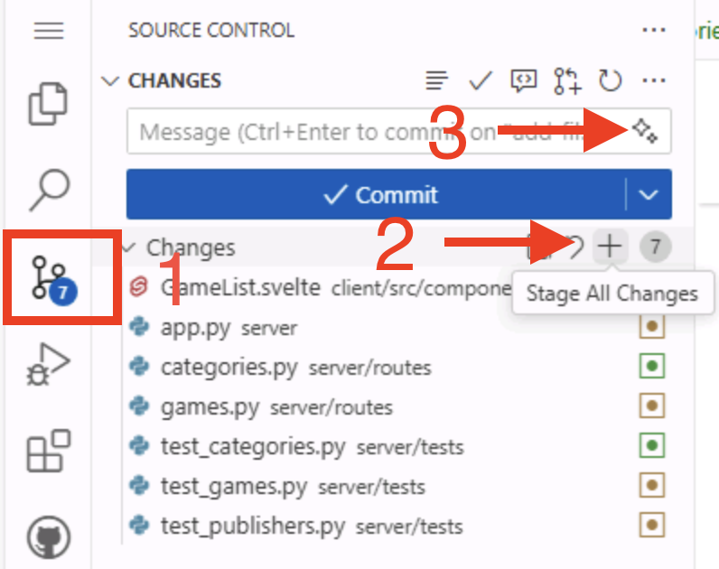

[← 前のレッスン: Agent mode][previous-lesson] · [次のレッスン: カスタムエージェント →][next-lesson]

agent mode でフィルタリング機能を作成しました。プル リクエストを開く前に、ブラウザーで実際に動くことを確認しましょう。自分でアプリを操作する代わりに、**Playwright MCP server** を接続し、Copilot に実際のブラウザーを操作させて機能をテストします。その後、ブランチを公開して PR を作成します。

この演習では、次のことを行います。

- Model Context Protocol (MCP) と、MCP server が Copilot にツールを追加する仕組みを学びます。
- workspace に Playwright MCP server を追加します。
- Copilot に Playwright を使わせて、ブラウザーでフィルタリング機能を手動テストします。
- ブランチを公開して、フィルタリング作業のプル リクエストを作成します。

## Model Context Protocol (MCP) とは

agent mode は、エディターの外部にあるツールを利用できると、さらに便利になります。Copilot が外部ツールやサービスと通信するために使う標準が Model Context Protocol (MCP) です。


[Model Context Protocol (MCP)](https://github.blog/ai-and-ml/llms/what-the-heck-is-mcp-and-why-is-everyone-talking-about-it/) を使うと、AI エージェントは外部ツールやサービスと通信できます。MCP を通じてリソースから最新情報を取得し、ツールを使ってユーザーに代わる操作を実行できます。

これらのツールやリソースには、AI エージェントと外部サービスの間をつなぐ MCP server を通じてアクセスします。MCP server は、既存 API や NPM package などのローカル ツールとの通信を管理します。各 server は、エージェントが利用できるツールとリソースのセットを提供します。

よく使われる MCP server の例を次に示します。

- **[GitHub MCP Server](https://github.com/github/github-mcp-server)**: GitHub リポジトリを管理する API を利用できます。リポジトリの作成や更新、Issue とプル リクエストの管理などをエージェントが実行できます。
- **[Playwright MCP Server](https://github.com/microsoft/playwright-mcp)**: Playwright によるブラウザー自動化を利用できます。Web ページへの移動、フォームへの入力、ボタンの選択などをエージェントが実行できます。

ほかにもさまざまなツールやリソースにアクセスできる MCP server があります。GitHub は、エコシステム内の MCP server を見つけやすくし、貢献を促すために [MCP registry](https://github.com/mcp) をホストしています。

> [!CAUTION]
> セキュリティの観点から、MCP server もほかの依存関係と同様に扱ってください。利用前にソース コードを慎重に確認し、発行元を検証して、セキュリティへの影響を検討します。信頼できる MCP server のみを使い、機密リソースや操作へのアクセス許可には注意してください。

## MCP の設定を確認する

`.vscode/mcp.json` ファイルで、この VS Code workspace から利用できる MCP server を設定します。

1. Codespace で `.vscode/mcp.json` を開きます。
2. `github` server がすでに設定されています。

   ```json
   {
     "servers": {
       "github": {
         "type": "http",
         "url": "https://api.githubcopilot.com/mcp/"
       }
     }
   }
   ```

`github` の設定はプロジェクト テンプレートに含まれています。そのため、前の演習で Copilot が Issue のバックログを読み取れました。これは[リモート GitHub MCP server][remote-github-mcp-server]を使用します。ローカルへのインストールは不要です。VS Code は HTTP で接続し、Copilot が初めてツールを使うときに GitHub で認証します。

## Playwright MCP server を追加する

次に 2 つ目の server を追加します。[Playwright MCP server][playwright-mcp-server] により Copilot がブラウザーを操作できるため、機能のテストに使えます。

1. `.vscode/mcp.json` で `github` と並べて `playwright` を追加し、ファイルを次のようにします。

   ```json
   {
     "servers": {
       "github": {
         "type": "http",
         "url": "https://api.githubcopilot.com/mcp/"
       },
       "playwright": {
         "command": "npx",
         "args": ["@playwright/mcp@latest", "--headless"]
       }
     }
   }
   ```

2. ファイルを保存します。

リモートの `github` server と異なり、`playwright` はローカル server です。VS Code は `npx @playwright/mcp@latest` を実行して起動します。`--headless` flag は、デスクトップ画面がない Codespace で必要な、ブラウザーを画面表示しない動作を指定します。

> [!NOTE]
> Tailspin Toys では end-to-end test に Playwright を使うため、必要なブラウザーは通常すでにインストールされています。Copilot がブラウザー不足を報告した場合は、`npx playwright install chromium` を実行して再度試すよう依頼します。

## server を起動して信頼する

VS Code は MCP server を**必要に応じて**起動します。Copilot が初めてその server のツールを使うときに server を起動し、信頼するか確認します。

1. `.vscode/mcp.json` で `playwright` の上に **Start** 操作が表示されます。選択して server を起動し、設定が正しいことを確認します。
2. VS Code から server を信頼するか尋ねられたら、設定を確認して信頼できる場合に許可します。

手動で起動する必要はありません。省略した場合は、次の手順で Copilot が初めてツールを使うときに VS Code が起動し、信頼を確認します。

## フィルタリング機能をテストする

[Playwright MCP server][playwright-mcp-server] を使うと、Copilot が実際のブラウザーを操作できます。自分でアプリを操作する代わりに、エージェントがページを開き、移動し、フィルターを適用し、結果を確認して報告します。会話を中断せずに、機能が期待どおりに動くかすばやく確認できます。

Playwright MCP server はスクリーンショットではなく、ページの[アクセシビリティ ツリー][playwright-mcp-server]を使います。エージェントは支援技術と同じように、label 付きの button、link、list item などの構造化要素を読み取ります。そのため、機能の簡単なテストをアクセシビリティの基本確認にも役立てられます。

server を接続してアプリを起動した状態で、Copilot にフィルタリング機能を試すよう依頼します。

```text
Using the Playwright MCP server, open a browser to the running app at http://localhost:4321 and verify the new game filtering feature:

1. Go to the games page and note how many games are listed.
2. Apply a category filter and confirm the list updates to only show games in that category.
3. Clear it, then apply a publisher filter and confirm the list updates to that publisher.
4. Combine a category and a publisher filter and confirm the results respect both.

Report what you observe at each step, and call out anything that does not behave as expected.
```

Copilot は Playwright MCP server でブラウザーを起動し、各手順を実行して結果を報告します。Issue の受け入れ条件に照らして報告内容を確認してください。問題がある場合は、プル リクエストを開く前に追加の質問をするか、コードを修正するよう依頼します。

> [!NOTE]
> このテストには、アプリが `http://localhost:4321` で起動している必要があります。dev server を停止した場合は、プロンプトを送る前に再起動します。Playwright MCP server を初めて使うときは、ブラウザーのダウンロードが必要な場合があります。ブラウザーがないと報告された場合は `npx playwright install chromium` を実行して再度試すよう依頼します。

[playwright-mcp-server]: https://github.com/microsoft/playwright-mcp

## ブランチを公開してプル リクエストを作成する

機能が動作することを確認したので、チームでレビューするためのプル リクエスト (PR) を作成します。まず `filtering-vscode` ブランチを公開します。

1. Codespace の **Source Control** パネルに移動し、Copilot が加えた変更を確認します。
2. **+** アイコンを選択して変更を stage します。
3. **Sparkle** ボタンで commit message を生成します。

   

4. **Publish** を選択してブランチをリポジトリに push します。

## プル リクエストを作成する

github.com や GitHub command-line interface (CLI) など、プル リクエストを作成する方法はいくつかあります。ここでは GitHub Copilot に作成を依頼します。Copilot は関連 Issue を探し、関連付けられた PR を作成できます。

1. Copilot Chat パネルを開き、**New Chat** を選択して新しいセッションを開始します。
2. agent dropdown で **Agent** が選択されていることを確認します。Copilot が GitHub ツールを使えるようになります。
3. 次のように依頼します。

   ```plaintext
   Find the issue in the repo related to filtering by category and publisher. Create a new pull request for the current branch, and associate it with the correct issue.
   ```

4. Copilot が情報を集めて操作を行うために **Continue** を求めたら選択します。GitHub tool の初回利用時に GitHub 認証を求められる場合があります。画面の案内に従います。
5. Copilot が Issue を検索し、該当するものを見つけて PR を作成する様子を確認します。
6. Copilot が表示したリンクを選択して PR をレビューします。**まだマージしないでください**。

## まとめと次のステップ

この演習では、MCP と MCP server が Copilot にツールを追加する仕組みを学び、workspace に Playwright MCP server を追加し、ブラウザーでフィルタリング機能を手動テストしてからブランチを公開し、PR を作成しました。

MCP server を使って機能をテストしましたが、MCP は Copilot を拡張する方法の 1 つです。次は、アクセシビリティ レビューのような作業を効率化する[カスタムエージェントを作成します][next-lesson]。

## リソース

- [MCP とは何か、なぜ注目されているのか][mcp-blog-post]
- [Microsoft Playwright MCP Server][playwright-mcp-server]
- [GitHub MCP Server][github-mcp-server]
- [GitHub MCP Registry][mcp-registry]
- [VS Code の MCP server][vscode-mcp-config]

[previous-lesson]: ../2-agent-mode/
[next-lesson]: ../4-custom-agents/
[mcp-blog-post]: https://github.blog/ai-and-ml/llms/what-the-heck-is-mcp-and-why-is-everyone-talking-about-it/
[github-mcp-server]: https://github.com/github/github-mcp-server
[mcp-registry]: https://github.com/mcp
[remote-github-mcp-server]: https://github.blog/changelog/2025-06-12-remote-github-mcp-server-is-now-available-in-public-preview/
[vscode-mcp-config]: https://code.visualstudio.com/docs/agents/reference/mcp-configuration
